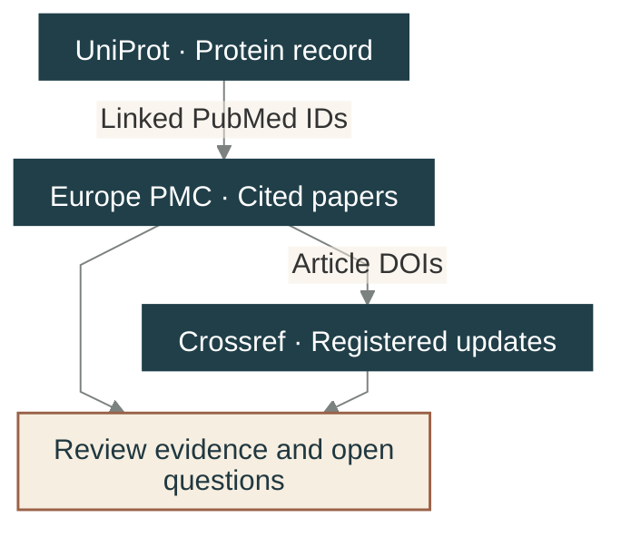

# BioSymphony BioProspector

Give your agent this repository and a computational biology question.
BioProspector gives it a [tool catalog](docs/tool-stack.md) and an
[agent skill](skills/bioprospector/SKILL.md) for choosing tools, setting up
computational experiments, and deciding what to run next. Your agent makes
the calls through its shell, APIs, or MCP connections.

## Give Your Agent a Task

```text
Use https://github.com/BioSymphony/bioprospector for this question: <question>.
Read the BioProspector skill and tool catalog. Choose tools for the inputs
you have, check what each call needs, and run the analysis where you have
access. Use each result to choose the next call. Return your findings, source
IDs, any conflicting evidence, and the follow-up most likely to change
the conclusion.
```

## What Your Agent Can Investigate

| Question | Tools and results |
| --- | --- |
| What evidence supports a protein annotation? | UniProt and Europe PMC return protein records and papers. Crossref returns publication updates. |
| Which proteins share a sequence or domain? | BLAST+, DIAMOND, and MMseqs2 return sequence hits. HMMER with Pfam returns domain matches. |
| What does the structure or genome context add? | Foldseek finds structural neighbors. cblaster compares gene neighborhoods, and MIBiG provides reference cluster records. |
| How do proposed pathway steps compare with known reactions? | Rhea provides curated reaction records for comparing proposed steps. |
| How can I set up and repeat an analysis? | Plan a baseline, inputs, controls, and expected outputs. Use Nextflow or Snakemake when a workflow needs repeatable steps. |

## Use One Result to Choose the Next Tool

To check a published lactose-hydrolysis annotation, your agent follows the
references from the protein record to the underlying papers.



If the papers leave the annotation uncertain, your agent can look for a
study that tests it directly.

Use the [tool catalog](docs/tool-stack.md) for inputs and use cases, the
[integration guide](docs/TOOL_INTEGRATIONS.md) for result formats, and the
[tool review](docs/opportunity-radar.md) for recent releases and evaluations.
The [CLI reference](docs/CLI_REFERENCE.md) covers bundled commands for
importing results, validating records, and comparing candidates.
