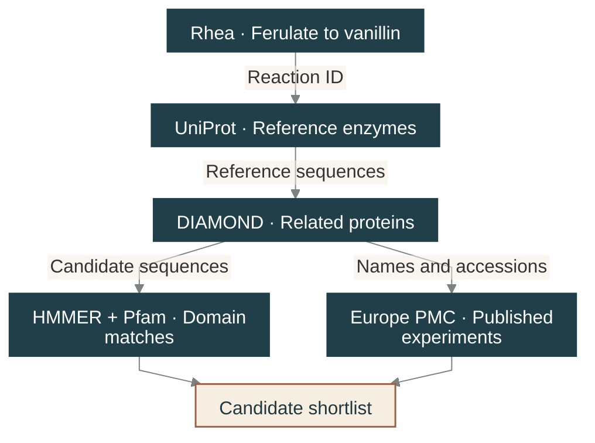

# BioSymphony BioProspector

Point your agent at this repository to find enzyme candidates, compare
biosynthetic pathways, or design and run computational experiments.

The [agent skill](skills/bioprospector/SKILL.md) covers tool selection,
setup, controls, and analysis. Your agent runs tools through its shell,
APIs, or MCP connections and passes identifiers and files between calls.
The [tool catalog](docs/tool-stack.md) describes inputs, outputs, and use
cases. BioProspector links the results to candidates and reaction steps
for ranking and reporting.

## Find Enzymes for a Vanillin Pathway

Which enzymes could convert ferulate to vanillin? Start with
[RHEA:76491](https://www.rhea-db.org/rhea/76491) and its linked UniProt
records. Search a chosen proteome with those reference sequences using
DIAMOND. Retrieve the hit sequences for HMMER/Pfam domain searches, then
look up activity measurements on ferulate in Europe PMC.

The literature can change the shortlist. Gallage and colleagues reported
that a vanilla enzyme converted ferulate to vanillin. Yang and colleagues
did not reproduce the conversion with that enzyme alone. Keep both results
with the candidate. [Gallage et al.](https://pubmed.ncbi.nlm.nih.gov/24941968/)
· [Yang et al.](https://pubmed.ncbi.nlm.nih.gov/28411481/)

## Compare Enzyme Rankings

Test whether domain evidence improves sequence-based rankings. Define activity
labels from published measurements, keeping disputed assignments separate.
Hold out characterized proteins for testing and keep close homologs together
when separating the reference and test sets.

Rank the same test proteins by sequence similarity, then add domain evidence.
Count proteins with measured activity or inactivity in each ranking’s top
ten. Use Nextflow or Snakemake to repeat the comparison with the same inputs
and database releases. Return both rankings, activity
citations, and the commands and versions needed to reproduce the analysis.

## Tools by Research Question

| Question | Tools | Results |
| --- | --- | --- |
| Which papers support an enzyme assignment? | UniProt, PubMed, Europe PMC, OpenAlex MCP | Protein accessions, cited papers, and the evidence each paper reports |
| Has a source changed? | bioRxiv, Crossref, Retraction Watch | Preprint versions and linked correction or retraction notices |
| What values does the paper report? | Docling, MinerU, GROBID | Extracted table values and units, page locators, and bibliography records |
| Which proteins have similar sequences? | BLAST+, DIAMOND, MMseqs2 | Sequence matches, alignment scores, and coverage |
| Which domains are present? | HMMER and Pfam | Profile matches and domain boundaries |
| Where do function predictions disagree? | CLEAN, TopEC, ProtDETR | Predicted enzyme classes to compare with curated annotations |
| Which structures are similar? | Foldseek | Structural matches and alignment coverage |
| Does the gene neighborhood support an enzyme assignment? | NCBI Datasets, cblaster, antiSMASH, MIBiG | Candidate and reference neighborhoods, with supporting and conflicting evidence |
| Which reactions could connect two intermediates? | Rhea, ChEBI | Curated reaction IDs and chemical records |
| What could explain an unresolved pathway step? | Rhea, UniProt, HMMER, Europe PMC | Candidate enzyme families and evidence for single-enzyme or multi-step explanations |
| Which proposed route has stronger enzyme evidence? | Rhea, UniProt, Europe PMC | Stepwise comparison of measured activities, candidate enzymes, and missing assignments |
| Which assumptions change predicted product flux? | COBRApy, memote | Predicted flux under stated constraints and model quality checks |
| Can I reproduce a computational comparison? | Nextflow, Snakemake, RO-Crate | Workflow steps, tool versions, and links between inputs and outputs |

## Compare Routes and Host Models

Compare proposed vanillin routes by mapping intermediates to ChEBI and
reactions to Rhea. Link each step to UniProt candidates and published activity
in Europe PMC. Return a route comparison covering enzyme evidence, missing
steps, cofactor requirements, and cellular compartments.

To investigate a route in a published yeast model, add its reactions and
check the model with memote. Pass the model to
[COBRApy](https://cobrapy.readthedocs.io/en/latest/simulating.html) and compare
maximum predicted product flux with and without precursor uptake. Hold the
growth requirement and other exchange bounds fixed. Report the predictions
and the constraints that account for the difference.

## References

- [Campaign setup](docs/FIRST_CAMPAIGN.md)
- [Unresolved reactions and missing genes](docs/ambiguity-workflows.md)
- [Supported result formats](docs/TOOL_INTEGRATIONS.md)
- [Tool releases and evaluations](docs/opportunity-radar.md)
- [CLI commands](docs/CLI_REFERENCE.md)
