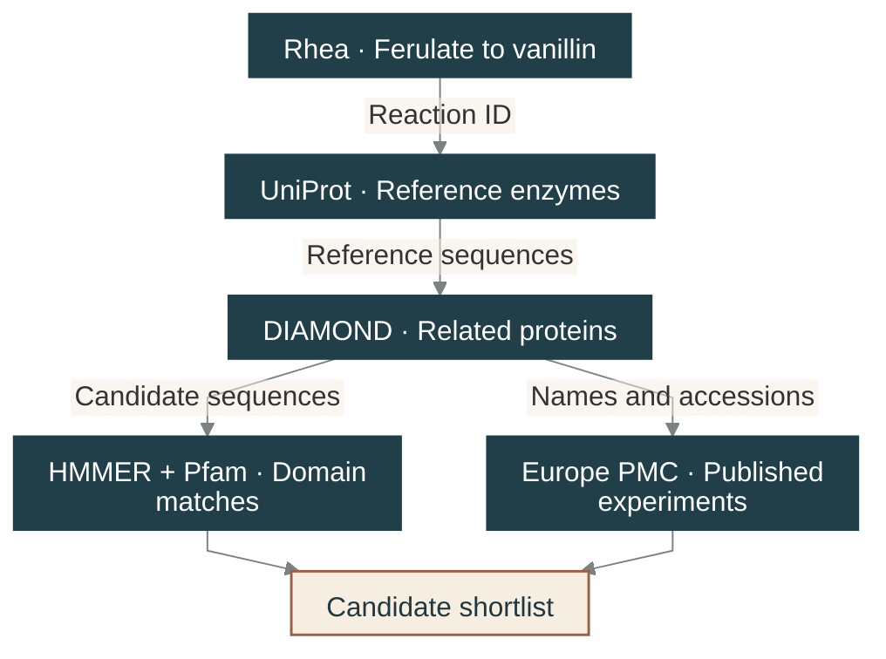

# BioSymphony BioProspector

Give your agent this repository and a target molecule. Ask which
biosynthetic routes are worth investigating. Your agent can find enzyme
candidates for each step and design computational experiments to compare them.

The [tool catalog](docs/tool-stack.md) lists what tools need and what they
return. The [agent skill](skills/bioprospector/SKILL.md) shows how to set up
computational experiments and pass results between tools. Your agent makes
the calls through its shell, APIs, or MCP connections.

## Find Enzymes for a Vanillin Pathway

Which enzymes could convert ferulate to vanillin? Start with
[RHEA:76491](https://www.rhea-db.org/rhea/76491) and its linked UniProt
records. Use sequence and domain searches to find related proteins, then
check the literature for activity measurements on ferulate.

The literature can change the shortlist. Gallage and colleagues reported
that a vanilla enzyme converted ferulate to vanillin. Yang and colleagues
did not reproduce the conversion with that enzyme alone. Keep both results
with the candidate. [Gallage et al.](https://pubmed.ncbi.nlm.nih.gov/24941968/)
· [Yang et al.](https://pubmed.ncbi.nlm.nih.gov/28411481/)

## Do Domain Matches Improve the Shortlist?

Rank the same proteins twice, once by sequence similarity and once with
domain matches added. Hold out enzymes with measured activity from the
reference set. Use close relatives with measured inactivity on ferulate as
negative controls. Count the known active enzymes in each ranking’s top ten.
Keep disputed activity out of the benchmark labels.

Return both rankings and cite the activity measurements. Record the tool
versions, database releases, and test accessions so the analysis can be rerun.

## Tools by Research Question

| Question | Tools | Results |
| --- | --- | --- |
| Which papers support an enzyme assignment? | UniProt, PubMed, Europe PMC, OpenAlex MCP | Protein accessions, cited papers, and the evidence each paper reports |
| Has a source changed? | bioRxiv, Crossref, Retraction Watch | Preprint versions and linked correction or retraction notices |
| What values does the paper report? | Docling, MinerU, GROBID | Extracted table values and units, page locators, and bibliography records |
| Which proteins have similar sequences? | BLAST+, DIAMOND, MMseqs2 | Sequence matches, alignment scores, and coverage |
| Which domains are present? | HMMER and Pfam | Profile matches and domain boundaries |
| Where do function predictions disagree? | CLEAN, TopEC, ProtDETR | Predicted enzyme classes to compare with curated annotations |
| Which structures are similar? | Foldseek | Structural matches and alignment coverage |
| What is near the candidate gene? | NCBI Datasets, cblaster, antiSMASH, MIBiG | Assembly accessions, neighboring genes, and reference cluster records |
| Which reactions could connect two intermediates? | Rhea, ChEBI | Curated reaction IDs and chemical records |
| What assumptions affect a metabolic model? | COBRApy, memote | Model constraints and quality checks |
| Can I reproduce a computational comparison? | Nextflow, Snakemake, RO-Crate | Workflow steps, tool versions, and links between inputs and outputs |

## More Questions to Give Your Agent

- Which steps in two proposed routes have measured enzyme activity, and
  which still lack a candidate with direct evidence?
- Does the gene neighborhood support an enzyme assignment? Compare candidate
  neighborhoods against reference clusters and report disagreements.
- Does a strain's metabolic model support a proposed route? Compare flux
  predictions under two sets of constraints and report which assumptions
  change the result.

## References

- [Campaign setup](docs/FIRST_CAMPAIGN.md)
- [Supported result formats](docs/TOOL_INTEGRATIONS.md)
- [Tool releases and evaluations](docs/opportunity-radar.md)
- [CLI commands](docs/CLI_REFERENCE.md)
