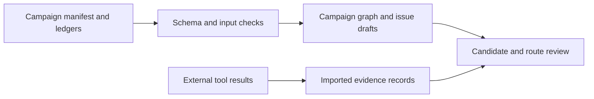

# Architecture

A campaign starts with a manifest and evidence ledgers. BioProspector validates
those files, builds a dependency graph, and writes reports for review. Your
agent runs research tools and imports compact results into the campaign.

## Artifact Flow

| Component | Role |
| --- | --- |
| Manifest | Names the target contract and ledgers |
| Preflight and input audit | Check ledger structure and identify missing inputs |
| Campaign graph and issue drafts | Record dependencies and review tasks |
| Importers and normalizers | Turn supported tool outputs into evidence records |
| Ranking and export | Compare recorded scores and write the review report |

Use the [integration guide](TOOL_INTEGRATIONS.md) for input formats and the
[ledger reference](dossier-schema.md) for field definitions.

## Coordination and Compute

Use the CLI locally or coordinate work with [Symphony and Linear](symphony-linear-sidecar.md).
The [workflow guide](WORKFLOWS.md) covers handoffs for larger runs and the
execution records they return.
