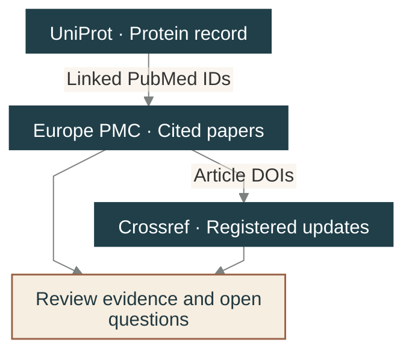

# BioSymphony BioProspector

Give your agent this repository and a computational biology question.
The [tool catalog](docs/tool-stack.md) explains what tools take and return.
The [agent skill](../SKILL.md) guides experiment setup, tool
selection, and follow-up. Your agent runs tools through its shell, APIs, or
MCP connections.

## Tools by Research Question

| Question | Tools | Results |
| --- | --- | --- |
| Which papers support an annotation? | UniProt, PubMed, Europe PMC, OpenAlex MCP | Protein accessions, cited papers, and the evidence each paper reports |
| Has a source changed? | bioRxiv, Crossref, Retraction Watch | Preprint versions and linked correction or retraction notices |
| What values does the paper report? | Docling, MinerU, GROBID | Extracted table values and units, page locators, and bibliography records |
| Which proteins have similar sequences? | BLAST+, DIAMOND, MMseqs2 | Sequence matches, alignment scores, and coverage |
| Which domains are present? | HMMER and Pfam | Profile matches and domain boundaries |
| Where do function predictions disagree? | CLEAN, TopEC, ProtDETR | Predicted enzyme classes to compare with curated annotations |
| Which structures are similar? | Foldseek | Structural matches and alignment coverage |
| What is near the candidate gene? | NCBI Datasets, cblaster, antiSMASH, MIBiG | Assembly accessions, neighboring genes, and reference cluster records |
| Which known reactions support a proposed step? | Rhea, ChEBI | Reactants, products, and reaction identifiers |
| What assumptions affect a metabolic model? | COBRApy, memote | Model constraints and quality checks |
| Can I reproduce a computational comparison? | Nextflow, Snakemake, RO-Crate | Workflow steps, tool versions, and links between inputs and outputs |

## Example Tasks

- Compare the published activity measurements for two enzyme candidates.
  Check whether the experiments used comparable conditions.
- Check whether a preprint revision changes a cited claim, and point to
  the passage in each version.
- Compare two domain annotation methods on the same reference set.
  Use curated domain boundaries as the baseline and report disagreements.

## Trace a Protein Annotation

To check a lactose-hydrolysis annotation, review the experiments cited in
the protein record.

## References

- [Supported result formats](docs/TOOL_INTEGRATIONS.md)
- [Tool releases and evaluations](docs/opportunity-radar.md)
- [CLI commands](docs/CLI_REFERENCE.md)
